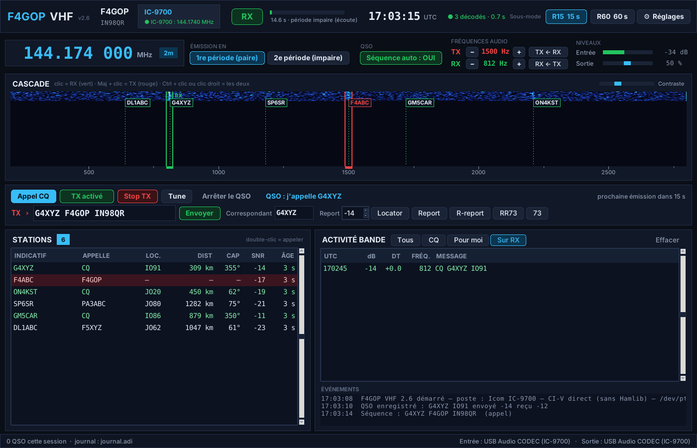
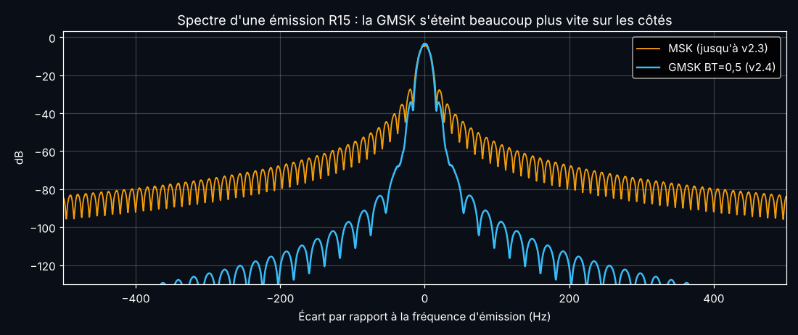
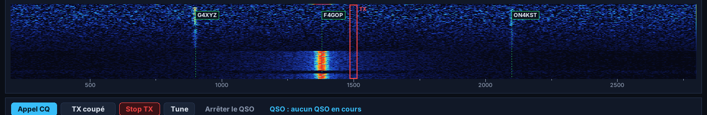
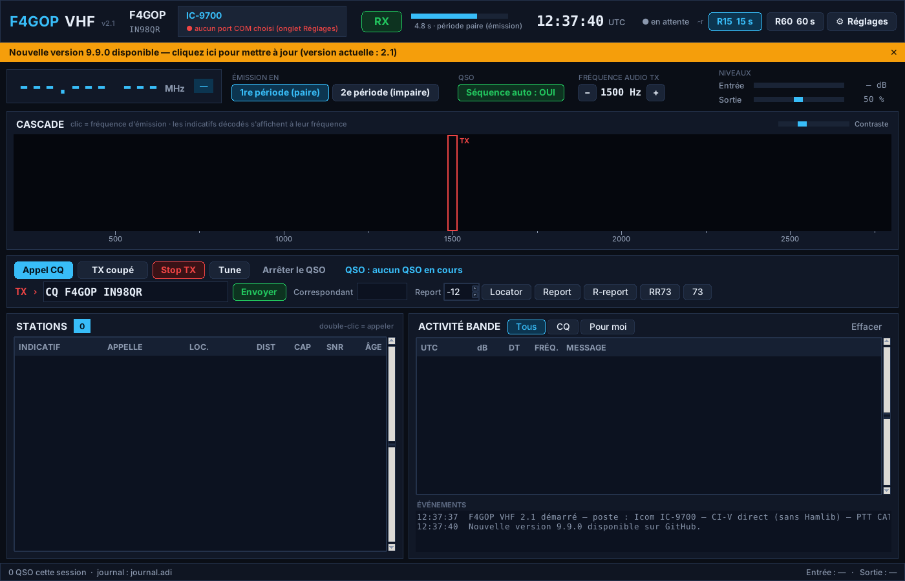
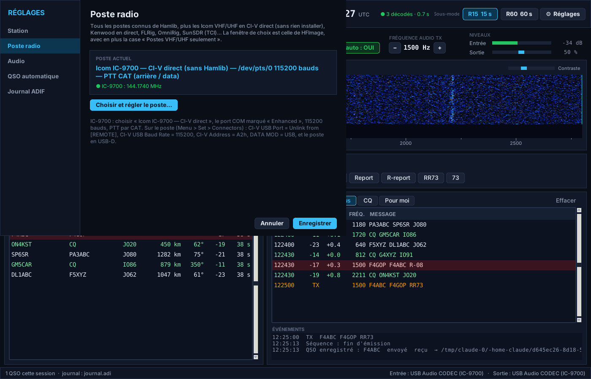
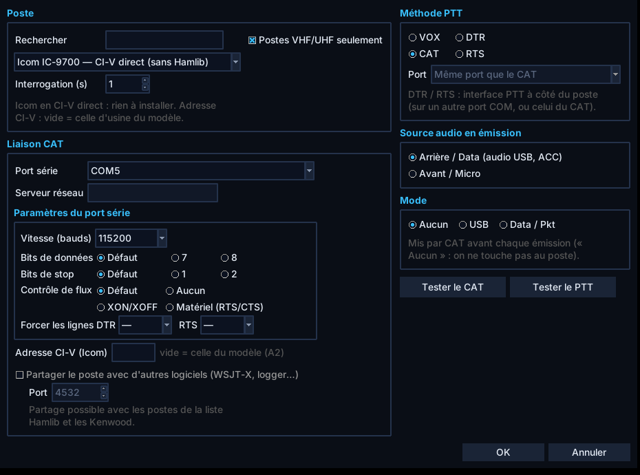
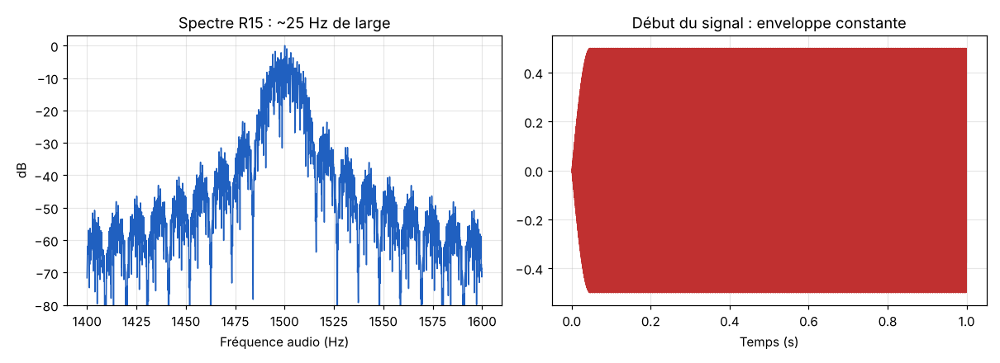

# Mode numérique VHF/UHF — F4GOP

Projet de mode numérique pour la VHF/UHF, dans l'esprit de FT8 / Q65,
mais conçu pour décoder des signaux plus faibles grâce à la
**démodulation cohérente** (les trajets tropo VHF/UHF sont bien plus
stables en phase que les trajets HF).

Auteur : Denis F4GOP (IN98QR) — f4gop.denis@gmail.com
Licence : **GNU GPL v3** (voir `LICENSE`). Le module « Poste radio » est
repris de **HFImage F4GOP** (même auteur, GPL v3). Programme écrit avec
l'aide d'une intelligence artificielle (Claude, d'Anthropic).



## Repères TX rouge / RX vert, comme WSJT-X (depuis la version 2.6)

- **Clic** dans la cascade : fréquence de **réception** (trait vert).
- **Maj + clic** : fréquence d'**émission** (trait rouge).
- **Ctrl + clic** ou **clic droit** : les deux à la fois.
- **Double-clic sur une station** : le RX se place sur elle (le TX ne
  bouge pas) ; boutons **TX ← RX** et **RX ← TX** pour les aligner.
- Filtre **« Sur RX »** dans Activité bande : seulement les messages
  reçus sur la fréquence RX.

## Spectre propre : GMSK (depuis la version 2.4)

La modulation est une **GMSK BT = 0,5** : la MSK d'origine lissée par un
filtre gaussien (comme FT8 et le GSM). Enveloppe toujours constante,
même récepteur (les versions précédentes se décodent entre elles), perte
de sensibilité 0,16 dB seulement, et un spectre qui s'éteint beaucoup
plus vite sur les côtés :

| Niveau à côté du signal (R15) | ±100 Hz | ±200 Hz | ±400 Hz |
|-------------------------------|---------|---------|---------|
| MSK (jusqu'à la v2.3)         | −61 dB  | −70 dB  | −90 dB  |
| **GMSK BT=0,5 (v2.4)**        | **−87 dB** | **−106 dB** | **−125 dB** |



Depuis la v2.5, la cascade a une **échelle de couleurs automatique**
(du bruit aux signaux les plus forts, mesurés en continu) et une fenêtre
de Blackman-Harris : un signal très fort (poste à côté, +60 dB) n'est
plus un gros bloc rouge, et les signaux faibles restent visibles.



Pendant l'émission, la cascade ne dessine plus notre propre signal
(entendu à un niveau énorme par le récepteur), comme WSJT-X.

## Mise à jour automatique (depuis la version 2.1)

Au démarrage (puis toutes les 3 heures), le programme regarde s'il
existe une version plus récente dans les *Releases* de ce dépôt. Si oui,
un **bandeau orange** apparaît : un clic télécharge le nouvel .exe,
vérifie sa taille et son empreinte SHA-256, remplace l'ancien et
redémarre le programme. Réglages → Station : case « Vérifier au
démarrage » et bouton « Vérifier maintenant ». Module `updater.py` repris
de HFImage F4GOP (`tests/test_mise_a_jour.py` : test complet avec un
faux serveur GitHub).



## Version 2.0 — interface moderne

- **Fenêtre sombre** : barre du haut (poste et fréquence lus en CAT,
  RX/TX, avancement de la période, heure UTC, sous-mode), cascade avec
  les indicatifs décodés affichés à leur fréquence, commandes d'émission
  (Appel CQ, TX, Stop TX, Tune, messages rapides), tableau **Stations**
  (locator, distance, cap, SNR, âge) et **Activité bande** (filtres
  Tous / CQ / Pour moi). Double-clic = appeler.
- **Fenêtre Réglages** : Station, Poste radio, Audio, QSO automatique,
  Journal ADIF.
- **Tous les postes** : la fenêtre « Poste radio » de HFImage (tous les
  postes Hamlib, Kenwood en direct, FLRig, OmniRig, SunSDR TCI,
  commandes personnalisées ; PTT par CAT, DTR, RTS ou VOX), avec en plus
  la case **« Postes VHF/UHF seulement »** et les **Icom VHF/UHF en CI-V
  direct**, sans rien installer : IC-9700, IC-705, IC-905, IC-9100,
  IC-7100, IC-910H, IC-7000, IC-706MkIIG, IC-746PRO, IC-821H, IC-820H,
  IC-970, IC-475, IC-275. Les autres (FT-991, FT-847, FT-817/818,
  FT-857/897, TS-2000, TS-790…) passent par Hamlib, installé en un clic
  depuis la fenêtre.
- **Le port COM ne peut plus bloquer le programme** : tout passe par un
  fil séparé (`liaison.py`).
- Test de bout en bout **en temps réel dans la vraie fenêtre**
  (`tests/test_qso_reel.py`) : CQ décodé à −17 dB, QSO automatique
  complet avec un faux IC-9700, enregistré dans le journal avec la bande
  et la fréquence lues en CAT.

| Réglages | Poste radio |
|---|---|
|  |  |

## Historique du projet

**Étape 0 — Simulateur (fait)**
`simulateur.py` compare les modulations à message égal (77 bits utiles
+ CRC, comme FT8) et à code correcteur égal. Seuils de décodage (50 %),
SNR dans 2500 Hz :

| Modulation                              | 10,4 s   | 60 s     |
|-----------------------------------------|----------|----------|
| 8-FSK non cohérent (principe FT8 / Q65) | −20,0 dB | −27,4 dB |
| BPSK cohérent (phase idéale)            | −23,9 dB | −31,5 dB |

Gain d'environ **4 dB** pour la démodulation cohérente, avec une phase
parfaitement connue.

**Étape 1 — Phase réelle (fait)**
`simulateur_phase.py` : le récepteur retrouve lui-même la fréquence et
la phase (pilotes 1 symbole sur 4, FFT, moyenne glissante, puis 2e passe
assistée par les bits décodés). La 8-FSK de référence paie la même part
de synchro que FT8 (21 symboles sur 79). Gain du BPSK cohérent :

| Stabilité (temps de cohérence Tc)   | Trame 10,4 s | Trame 60 s |
|-------------------------------------|--------------|------------|
| GPSDO, tropo stable (1000 s)        | +4,1 dB      | +4,1 dB    |
| bon TCXO (30 s)                     | +3,9 dB      | +3,9 dB    |
| oscillateur moyen (3 s)             | +3,5 dB      | +2,2 dB    |
| très instable / scatter (0,5 s)     | +2,0 dB      | −2,8 dB    |

Conclusion : la démodulation cohérente garde l'essentiel de son gain
dès que la phase est un peu stable. Quand elle bouge trop vite pour
une trame longue, elle devient moins bonne que la FSK : le programme
devra mesurer la stabilité du signal et basculer tout seul vers un
mode non cohérent dans ce cas.

Résultats détaillés : `resultats_phase.txt`.

**Étape 2 — Code correcteur (fait)**
- `ldpc.py` : LDPC (194, 91) construit par PEG, décodage somme-produit.
  À cette petite taille de message il fait *moins bien* que le code
  convolutif (FT8 doit lui ajouter un décodeur OSD très lourd). Gardé
  pour de futurs messages longs.
- `convolutif.py` : codes convolutifs K=7, 9, 11. Le **K=11** gagne
  environ 0,6 dB sur le K=7 et se place à **0,3 dB de la limite
  théorique** pour 91 bits (approximation normale, −24,8 dB en 10,4 s).

Résultats avec phase réelle et code K=11 (`resultats_K11.txt`), même
code pour la référence de type FT8 :

| Trame  | Type FT8 | IC-9700 TCXO interne | IC-9700 + GPSDO |
|--------|----------|----------------------|-----------------|
| 10,4 s | −18,9 dB | **−23,0 dB** (+4,1)  | −22,9 dB (+4,0) |
| 60 s   | −26,6 dB | **−30,2 dB** (+3,6)  | −30,6 dB (+4,0) |

**Étape 3a — Émission (fait)**
- `message.py` : messages sur 77 bits + CRC-14. Types : standard
  (« CQ F4GOP IN98 », « F4ABC F4GOP -12 », R-report, RRR, RR73, 73),
  **locator 6 caractères** (« CQ F4GOP IN98QR ») et texte libre
  (13 caractères).
- `modem.py` : modulation **MSK cohérente** (OQPSK demi-sinus) :
  mêmes performances que le BPSK des simulations, mais **enveloppe
  constante** comme FT8 → l'émetteur sort toute sa puissance.
  Code K=11, 1 pilote tous les 4 bits, 272 bits émis.

| Sous-mode | Période | Émission | Largeur | Seuil mesuré (boucle audio) |
|-----------|---------|----------|---------|-----------------------------|
| R15       | 15 s    | 12,8 s   | ~25 Hz  | ≈ −24 dB                    |
| R60       | 60 s    | 55,5 s   | ~6 Hz   | ≈ −30 dB                    |

- (v1) PTT et fréquence de l'IC-9700 par CI-V, fenêtre d'émission —
  remplacés en v2 par `radio.py` / `liaison.py` et `f4gop_vhf.py`.
- `exemples/` : un CQ en WAV et son spectre.



**Étape 3b — Réception (fait)**
- `decodeur.py` : recherche des signaux sans rien connaître d'avance
  (fréquence 200–2800 Hz, décalage d'horloge −0,5 à +1,5 s) en
  additionnant les pilotes de façon cohérente, puis démodulation fine
  et décodage de tous les candidats en un seul passage. Le CRC 14 bits
  élimine les faux décodages.
- (v1) programme complet émission + réception —
  waterfall (clic = fréquence d'émission), liste des messages (en
  rouge ceux qui te sont adressés, en vert les CQ), double-clic pour
  répondre (locator, report, R-report, RR73, 73 selon l'étape du QSO).
- `tests/test_decodeur.py` : test sur périodes synthétiques
  (résultats dans `tests/resultats_decodeur.txt`).

| Sous-mode | Décodage à 50 %  | Temps de décodage | Faux décodages (bruit seul) |
|-----------|------------------|-------------------|-----------------------------|
| R15       | ≈ −23,5 dB       | 0,6 à 1,1 s       | 0 sur 30 périodes           |
| R60       | ≈ −30 dB         | 1,8 à 4 s         |                             |

Le décodage démarre dès la fin du signal le plus tardif possible
(14,85 s en R15, 57,5 s en R60), et l'émission peut partir jusqu'à
1,2 s après le début de période : on a le temps de répondre.

**Étape 3c — QSO automatique, journal, .exe (fait)**
- `sequenceur.py` : déroulement automatique des QSO (CQ → locator →
  report → R-report → RR73 → 73), reprise si un message est perdu,
  abandon après 6 émissions sans réponse
  (`tests/test_sequenceur.py`).
- `journal_adif.py` : chaque QSO est enregistré dans
  `Documents\F4GOP-VHF\journal.adi` (bande et fréquence lues sur
  l'IC-9700). Ce mode étant nouveau, il est noté MODE=MFSK,
  SUBMODE=F4GOP-VHF : certains logiciels ou LoTW peuvent refuser ce
  sous-mode inconnu.
- Test de bout en bout : deux stations complètes ont fait un QSO entier
  entre elles, avec de vrais signaux bruités à −18 dB, et l'ont
  chacune enregistré.
- `.github/workflows/exe-windows.yml` : GitHub construit
  **F4GOP-VHF.exe** sur Windows à chaque nouvelle version et le publie
  dans les **Releases**.

## Utiliser le programme (Windows)

**Le plus simple** : télécharger **F4GOP-VHF.exe** dans la rubrique
*Releases* du dépôt (colonne de droite) et double-cliquer. Rien à
installer.

Pour un QSO :
1. **Réglages → Station** : indicatif et locator.
2. **Réglages → Poste radio → Choisir et régler le poste…** : par
   exemple « Icom IC-9700 — CI-V direct », le port COM marqué
   « Enhanced », 115200 bauds, PTT par CAT ; **Tester le CAT** puis
   **Tester le PTT** (sur charge fictive).
3. **Réglages → Audio** : « USB Audio CODEC » en entrée et en sortie.
4. Choisir le sous-mode **R15** ou **R60** en haut, puis **Appel CQ**, ou
   **double-clic** sur un CQ reçu : avec « Séquence auto : OUI », le QSO
   se déroule tout seul et s'enregistre dans le journal.

Depuis les sources :
```
pip install -r requirements.txt
python f4gop_vhf.py
```

Réglages de l'IC-9700 : mode **USB-D** (ou case « Mode : Data / Pkt »
de la fenêtre Poste radio pour que le programme le mette tout seul),
menu *Connectors* : CI-V USB Port = *Unlink from [REMOTE]*, CI-V USB
Baud Rate = 115200, CI-V Address = A2h, DATA MOD = USB. L'horloge du PC
doit être à l'heure exacte (synchronisation Internet), comme pour FT8.

Premiers essais : « Tester le PTT » sur charge fictive, puis niveau de
sortie réglé pour que l'ALC ne bouge pas.

## Lancer le simulateur

```
pip install numpy scipy matplotlib
python simulateur.py
python simulateur_phase.py 11      # K = 7, 9 ou 11
```
